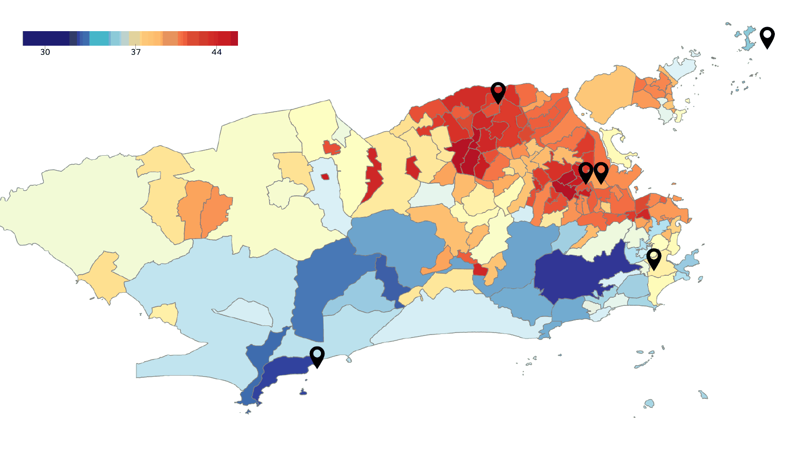
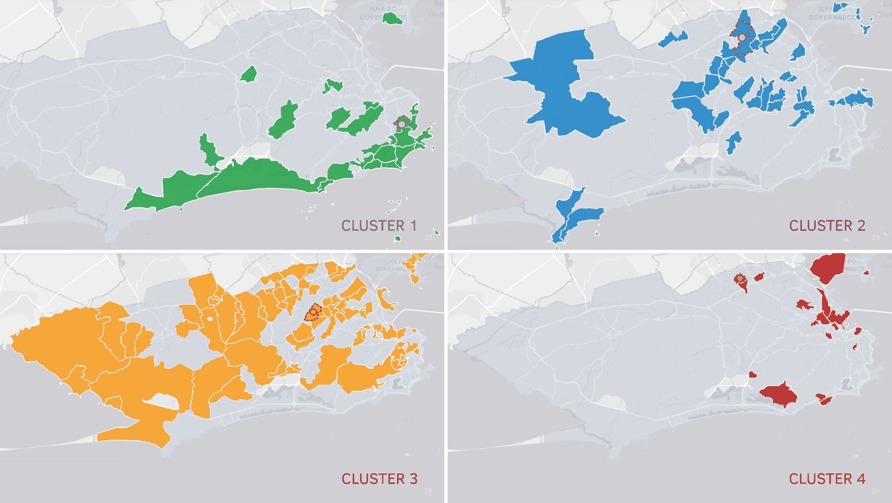

# Ilhas de calor e vulnerabilidade socioespacial no Rio de Janeiro


Projeto em equipe da disciplina **ENG4040 (Projeto Integrado 4)**, PUC-Rio, turma 33B, professora Amanda Batista.
Equipe **CCG, Ciência Climática em Grupo**.

## Equipe

Beatriz Ritter · Giulia Colucci · Gustavo Galvão · Luiza Lessa · Manuela Borba

Todos os integrantes contribuíram em todas as etapas do projeto: coleta e tratamento de dados, análise exploratória, modelagem, mapas e relatórios.

## Pergunta de pesquisa

Qual é a relação espacial entre a intensidade das ilhas de calor e a vulnerabilidade socioespacial nos bairros do Rio de Janeiro?


O calor urbano não se distribui ao acaso: concentra-se em territórios mais impermeabilizados, menos arborizados e historicamente mais pobres. O projeto cruza dados de temperatura de superfície com indicadores sociais e de infraestrutura para identificar os bairros mais expostos.

## Dados

- **Censo Demográfico 2022 (IBGE):** indicadores socioeconômicos e de saneamento por bairro.
- **Temperatura de superfície (LST):** imagens de satélite Landsat, agregadas por bairro.
- **Chuva:** estações do Alerta Rio, validadas com o INMET.

A base final cobre os bairros do município, com indicadores socioeconômicos em 162 deles. Os dados brutos não estão neste repositório. Consulte as fontes originais.

Temperatura de superfície média por bairro (Landsat 8/9): o calor se concentra no subúrbio denso da Zona Norte, e o litoral e as áreas de maciço ficam mais frios.



## Método

Aprendizado não supervisionado: **agrupamento por K-Medoids (algoritmo PAM) com distância de Manhattan**.

- O K-Medoids foi escolhido por ser robusto a valores extremos, que são fortes nos indicadores de saneamento, e porque cada grupo é representado por um bairro real (o *medoide*), o que facilita a interpretação.
- 7 variáveis de vulnerabilidade, normalizadas com Min-Max para equilibrar o peso de cada dimensão na distância de Manhattan: renda, população em favela, densidade, arborização, saneamento, pavimentação e analfabetismo.
- A temperatura de superfície fica fora do agrupamento e serve para validar os grupos depois.
- Escolha de K por TD (dissimilaridade total), silhueta, Davies-Bouldin e estabilidade por *bootstrap* com ARI.
- Interpretação com η² por atributo e uma matriz de risco que combina exposição térmica e vulnerabilidade social.

## Resultados

O grupo adotou **K = 4**. Cada grupo é representado por um bairro real (o medoide):

| Grupo | Bairro-arquétipo | Bairros | % da população | LST média | Renda mediana | População em favela |
|---|---|---:|---:|---:|---:|---:|
| Alta resiliência e baixa vulnerabilidade | Laranjeiras | 26 | 18,2% | 36,8 °C | R$ 8.270 | 6,3% |
| Vulnerabilidade baixa-média com alta exposição térmica | Irajá | 45 | 22,6% | 41,3 °C | R$ 2.920 | 7,3% |
| Vulnerabilidade estrutural intermediária | Madureira | 73 | 49,5% | 40,2 °C | R$ 2.102 | 22,1% |
| Hiper-vulnerabilidade crítica | Costa Barros | 18 | 9,8% | 40,6 °C | R$ 1.467 | 68,7% |

Métricas de validação para K de 2 a 6 estão em [`resultados/metricas_k_otimo_kmedoids.csv`](resultados/metricas_k_otimo_kmedoids.csv). A silhueta e a estabilidade por bootstrap são maiores em K = 3. O grupo escolheu K = 4 por validação substantiva, e não só pelas métricas: estabilidade mínima (ARI médio acima de 0,50), subdivisão coerente entre K e K+1 e um grupo adicional com perfil territorial próprio. A justificativa completa está no [relatório da Sprint 2](relatorios/Relatorio_Sprint_2.docx).

Dois pontos de leitura:

- **Arborização, renda e favelização** são os atributos que mais separam os grupos (η² entre 73% e 76%).
- Os grupos de vulnerabilidade explicam apenas cerca de **15% da variação da temperatura de superfície** (η² da LST), o que indica que o calor depende de fatores além dos sete indicadores usados no agrupamento.

O mapa interativo está em [`resultados/mapa_ilhas_calor_kmedoids.html`](resultados/mapa_ilhas_calor_kmedoids.html) (baixe e abra no navegador).

Os quatro grupos no mapa do município (grupo 1: Laranjeiras; grupo 2: Irajá; grupo 3: Madureira; grupo 4: Costa Barros):



Contribuição de cada atributo para separar os grupos (η²), com a temperatura de superfície só como referência externa:


## Sprint 3: comparação de técnicas de agrupamento

A Sprint 3 testou se o resultado do K-Medoids se sustenta diante de outras técnicas e de outras seleções de variáveis.

- **Duas seleções de 5 variáveis** a partir das 7 candidatas: **A**, por relevância (η² ≥ 0,14), e **B**, por redundância (poda de Spearman, |ρ| ≥ 0,70). A temperatura de superfície continua fora do agrupamento, como variável de controle. Os critérios estão em [`relatorios/Selecao_Variaveis_e_Limiares_Sprint3.md`](relatorios/Selecao_Variaveis_e_Limiares_Sprint3.md).
- **Três técnicas:** K-Medoids (distâncias Euclidiana e Manhattan), AGNES (ligações *average* e *complete*) e DBSCAN, com K de 3 a 5 quando aplicável.
- **Métricas:** cotovelo, silhueta, Davies-Bouldin, estabilidade por *bootstrap* (ARI), percentual de ruído e tamanho do maior e do menor grupo. Configurações degeneradas são marcadas como inválidas no ranking.
- **Ranking:** score composto por silhueta, Davies-Bouldin e ARI, em [`sprint3/resultados/comparacao_modelos/ranking_geral.csv`](sprint3/resultados/comparacao_modelos/ranking_geral.csv).

Ponto de atenção na leitura do ranking: as melhores posições são de AGNES com ligação *average* em K = 3, mas nelas um único grupo concentra cerca de 99% dos bairros (coluna `maior_grupo_pct`). O K-Medoids produz grupos mais equilibrados (maior grupo entre 46% e 60% em K = 3) e ARI de bootstrap entre 0,80 e 0,87. Os detalhes estão em [`relatorios/Comparacao_Modelos_Clustering_Sprint3.docx`](relatorios/Comparacao_Modelos_Clustering_Sprint3.docx).

## Estrutura

```text
ilhas-de-calor-rio/
├── sprint1_tratamento/     # notebooks de tratamento (calor, socioeconômico, clima e chuva)
├── dados_tratados/         # bases tratadas por trilha e dataset final unificado
├── analise_exploratoria/   # figuras e tabelas da análise exploratória
├── pipeline/               # Sprint 2: 6 etapas em Python + base de entrada (dados/)
├── notebooks/              # Sprint 2: versões em notebook das 6 etapas
├── resultados/             # Sprint 2: tabelas finais, mapa interativo e figuras dos clusters
├── imagens/                # slides das Sprints 1 e 2 usados neste README
├── sprint3/
│   ├── codigo/             # preparação dos datasets, K-Medoids e comparação de modelos
│   ├── dados/              # subsets A (η²) e B (Spearman), folds por bairro
│   └── resultados/         # métricas, figuras e explicações por técnica + ranking
├── relatorios/             # relatório da Sprint 2, documentos da Sprint 3, apresentação parcial
└── README.md
```

Os dados brutos (setores censitários do IBGE, malhas e imagens de satélite) ficam de fora por tamanho. As bases em `dados_tratados/` são a saída do tratamento.

## Como rodar a Sprint 2

```bash
pip install pandas numpy
cd pipeline
python 01_ingestao_limpeza.py
python 02_eda_selecao.py
python 03_preprocessamento_kmedoids.py
python 04_modelagem_kmedoids.py
python 05_perfilamento_matriz_kmedoids.py
python 06_geracao_outputs_kmedoids.py
```

Os scripts leem a base em `pipeline/dados/` e gravam as tabelas, o mapa interativo (Leaflet) e as figuras em `pipeline/outputs/`.

## Limitações

- O recorte por bairro pode distorcer os indicadores (problema da unidade espacial modificável, o MAUP).
- Quatro bairros ficaram sem dados socioeconômicos e a chuva cobre só parte dos bairros.
- O agrupamento descreve associação espacial, não causalidade.

## Referências

Kaufman, L. & Rousseeuw, P. J. (1990). *Finding Groups in Data: An Introduction to Cluster Analysis*. Wiley.
Sari et al. (2024). Analysis of Social Vulnerability in Java Island using K-Medoids Algorithm with Variation of Distance Measurements. *Indonesian Journal of Artificial Intelligence and Data Mining*, 7(2), 467–475.
